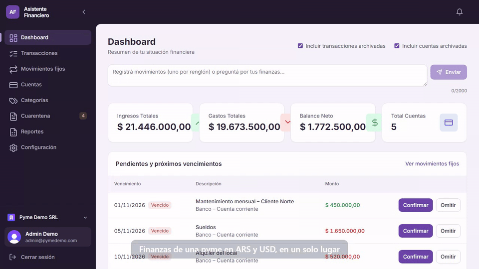
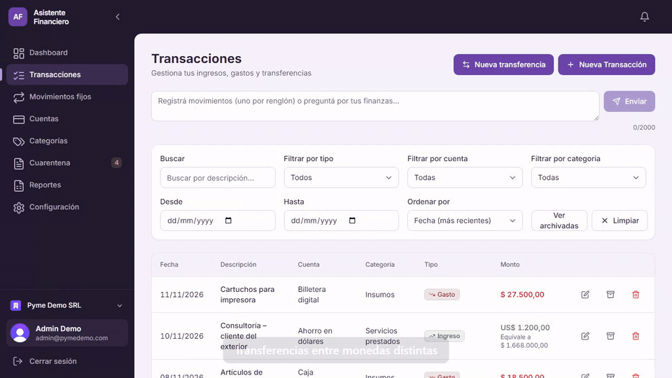
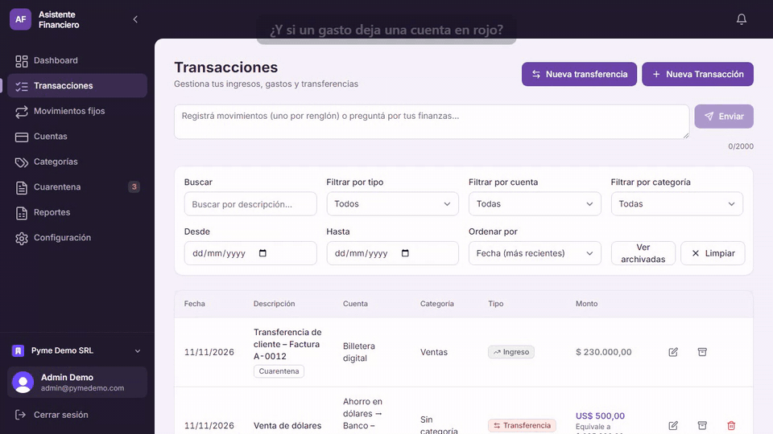
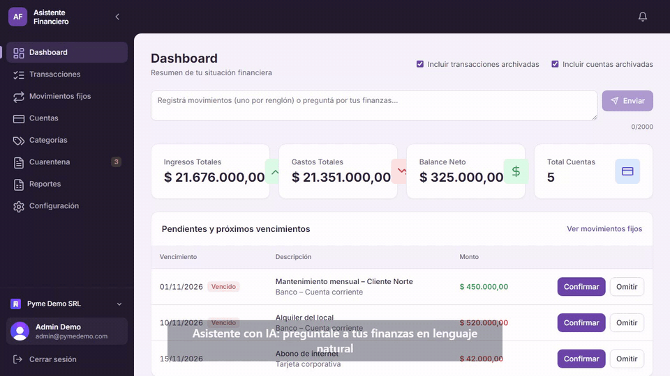
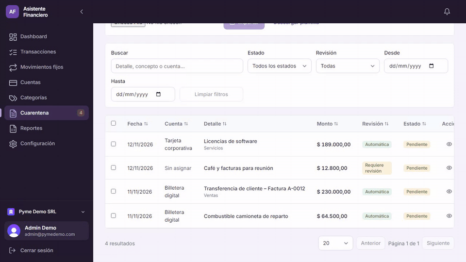
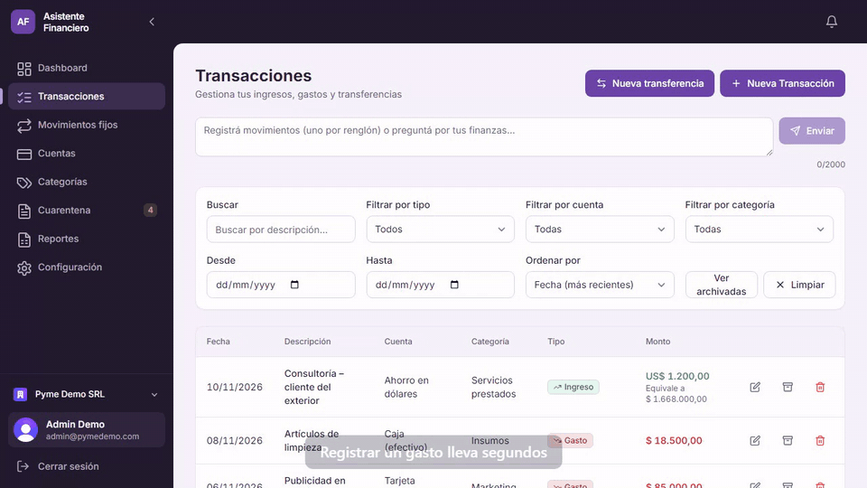
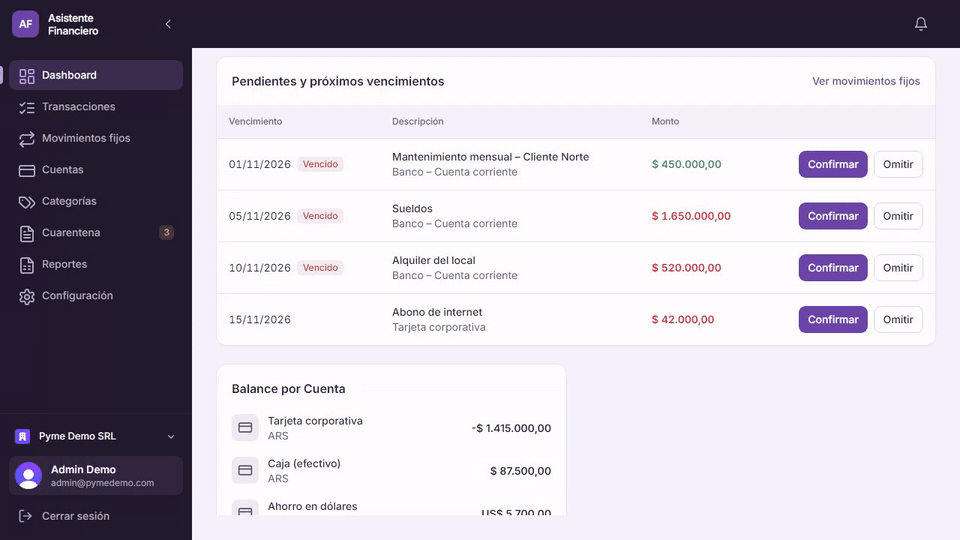
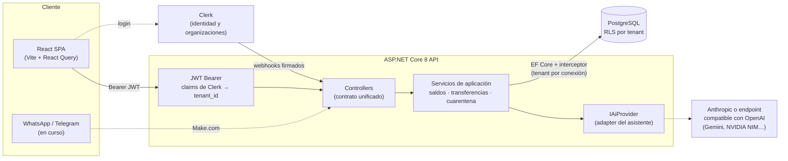

# Asistente Financiero

> Plataforma multi-empresa para registrar y entender las finanzas de un negocio: cuentas, categorías,
> transacciones y transferencias en ARS y USD, con saldos siempre consistentes y un dashboard en tiempo real.
> Diseñada para recibir movimientos por WhatsApp/Telegram y categorizarlos con IA.

Proyecto desarrollado por **Felipe Valenzuela** y **Diego Scopetta**. Este repositorio es una **vitrina**:
documenta el producto, la arquitectura y las decisiones técnicas. El código fuente vive en repositorios privados.

[Demo](#demo)  ·  [Arquitectura](docs/arquitectura.md)  ·  [Decisiones técnicas](docs/decisiones/)  ·  [Calidad y testing](docs/calidad.md)

---

## El problema

Las pymes y los profesionales independientes en Argentina suelen llevar sus finanzas en planillas sueltas:
varias cuentas (efectivo, bancos, billeteras virtuales, tarjetas), dos monedas con una cotización que cambia todos
los días y movimientos que llegan por WhatsApp o en un papel. El resultado son saldos que no cierran, gastos sin
categorizar y ninguna visión consolidada del negocio.

## La solución

Una aplicación web multi-empresa (multi-tenant) donde cada organización:

- **Registra sus cuentas** (efectivo, banco, tarjeta de crédito, billetera digital) en ARS o USD.
- **Carga ingresos, gastos y transferencias** entre cuentas, incluso entre monedas distintas: el monto acreditado se
  calcula con la cotización USD/ARS del día o se carga a mano.
- **Ve saldos siempre consistentes**: cada movimiento actualiza el saldo de forma atómica; solo las tarjetas de
  crédito pueden quedar en negativo y, si una operación dejaría otra cuenta en rojo, el sistema la rechaza con un
  mensaje que explica qué pasó y qué hacer.
- **Organiza** con categorías jerárquicas, archivado y borrado lógico (nada se pierde).
- **Entiende su situación** en un dashboard con ingresos, gastos, flujo neto, balance por cuenta, tendencia mensual
  y transacciones recientes editables.
- **Registra hablando**: en el asistente se escribe en lenguaje natural («3500 de súper con la Visa y cobré 50 mil»)
  y la **IA interpreta cada movimiento**; también responde consultas («¿en qué gastamos más este mes?») con los
  datos de la empresa.
- **Revisa antes de impactar**: lo que llega del asistente, de un CSV o del extracto de Mercado Pago queda en una
  bandeja de **cuarentena**; al aprobarlo se convierte en transacción.

Próximo paso: que los movimientos lleguen también por **WhatsApp/Telegram** (vía Make.com) a la misma bandeja.

## Demo

> Grabado sobre una empresa ficticia (**Pyme Demo SRL**) con datos de ejemplo: no hay datos reales de clientes.

### Transferencias entre monedas

El monto acreditado en pesos se calcula con la cotización USD/ARS del día; débito y crédito se registran como un par
atómico.

### Saldos que siempre cierran

Si un gasto dejaría una cuenta en rojo (y no es una tarjeta de crédito), el sistema lo rechaza y explica qué pasó y
qué hacer.

### Asistente con IA

Preguntas en lenguaje natural que se responden con los datos reales de la empresa.

### Bandeja de cuarentena

Los movimientos que llegan de afuera (CSV, extracto de Mercado Pago, webhook) se revisan antes de convertirse en
transacciones.

<b>Más: cargar un gasto y confirmar un movimiento fijo</b>

### Registrar un gasto

### Gastos e ingresos fijos

Cada mes vencido queda pendiente hasta que se confirma (se crea la transacción y se mueve el saldo) o se omite.

---

## Estado del proyecto

| Área | Estado |
|---|---|
| Autenticación y organizaciones (Clerk, JWT, alta automática de empresa y usuario) | ✅ Funcionando |
| Cuentas multi-moneda (ARS/USD), cambio de moneda con conversión | ✅ Funcionando |
| Categorías jerárquicas con archivado en cascada y borrado lógico | ✅ Funcionando |
| Transacciones con cálculo de monto en moneda base (ARS) por cotización | ✅ Funcionando |
| Saldos transaccionales, ajustes manuales auditables y transferencias atómicas | ✅ Funcionando |
| Dashboard con filtros y transacciones recientes editables | ✅ Funcionando |
| Contrato HTTP unificado + tests de contrato | ✅ Funcionando |
| Aislamiento multi-tenant (filtro por servicio + Row-Level Security forzado en PostgreSQL) | ✅ Funcionando |
| Roles y permisos (Owner/Admin escriben, Member solo lee) | ✅ Funcionando · 🗺 Función de Viewer después de la beta |
| Gastos e ingresos fijos (vencimientos pendientes, confirmar u omitir) | ✅ Funcionando |
| Bandeja de cuarentena: webhook, importación CSV y extracto de Mercado Pago | ✅ Funcionando · 🚧 Aviso de posible duplicado |
| Asistente con IA: registrar movimientos y consultar en lenguaje natural (adapter provider-agnostic) | ✅ Funcionando · 🚧 Elección del proveedor de producción |
| Exportación a Google Sheets | ✅ Funcionando · 🚧 Reconexión de la cuenta de Google desde la interfaz |
| Entrada por WhatsApp/Telegram (Make.com → webhook de la cuarentena) | 🚧 Webhook listo; escenario de Make en curso |
| Cotización diaria automática desde el BCRA | 🗺 Planificado (hoy: cotización cargada en base) |
| Importación desde Google Drive | 🗺 Después de la beta |
| Beta en producción | 🗺 Diciembre de 2026 |

---

## Stack

| Capa | Tecnologías |
|---|---|
| **Backend** | ASP.NET Core 8 (Web API), Clean Architecture + DDD ligero, EF Core 8 + Npgsql, FluentValidation |
| **Base de datos** | PostgreSQL 16, Row-Level Security para multi-tenancy, `decimal(18,2)` para montos, UUIDs |
| **Frontend** | React 18, TypeScript, Vite, TanStack React Query, Tailwind CSS, arquitectura por componentes |
| **Autenticación** | Clerk (organizaciones = tenants), validación JWT con `AddJwtBearer` + JWKS, webhooks firmados (Svix) |
| **IA** | Patrón Adapter (`IAiProvider`) con el proveedor elegido por configuración: Anthropic, cualquier endpoint compatible con OpenAI (Gemini, NVIDIA NIM, Ollama) o un mock para tests. Proveedor de producción en evaluación |
| **Testing** | xUnit + Testcontainers (PostgreSQL real), tests de contrato HTTP, Vitest + Testing Library |
| **DevOps** | Docker / Docker Compose, GitHub Actions (CI con migraciones y analizadores, CD a GHCR), guardas de ramas |

## Arquitectura en una imagen

Más detalle (capas, flujo de una transacción, consistencia de saldos, multi-tenancy y adapter de IA) en
**[docs/arquitectura.md](docs/arquitectura.md)**.

## Decisiones técnicas destacadas

| # | Decisión | Por qué |
|---|---|---|
| [0001](docs/decisiones/0001-multi-tenancy-con-rls.md) | Multi-tenancy en una sola base con Row-Level Security | Aislamiento a nivel de base de datos sin el costo operativo de una base por cliente |
| [0002](docs/decisiones/0002-adapter-ia-provider-agnostic.md) | Adapter de IA provider-agnostic | Cambiar de proveedor (Gemini, OpenAI, Anthropic, Ollama) sin tocar la lógica de negocio |
| [0003](docs/decisiones/0003-auth-gestionada-con-clerk.md) | Auth gestionada (Clerk) + validación JWT estándar | Organizaciones, MFA y gestión de sesiones resueltas; el backend solo valida tokens |
| [0004](docs/decisiones/0004-precision-financiera-y-multimoneda.md) | `decimal`, moneda base ARS y cotización guardada por transacción | Precisión exacta y reportes históricos que no cambian cuando cambia el dólar |
| [0005](docs/decisiones/0005-saldos-consistentes.md) | Saldos incrementales con bloqueo de filas | Saldos correctos bajo concurrencia, verificados con un invariante |
| [0006](docs/decisiones/0006-contrato-http-unificado.md) | Contrato HTTP unificado | Un solo formato de respuesta y error para todo el frontend |

## Calidad

- **~840 tests automatizados**: 162 unitarios + 324 de integración en el backend (PostgreSQL real con
  Testcontainers) y 354 en el frontend.
- Casos derivados de un **plan de pruebas con reglas de negocio numeradas** (D1–D24) y trazabilidad caso → regla.
- Tests de **concurrencia** (20 gastos en paralelo sobre la misma cuenta) y de **invariante** (50 operaciones
  aleatorias con semilla fija, el saldo siempre cuadra).
- CI con `dotnet format`, analizadores con *warnings as errors*, migraciones contra PostgreSQL y lint/typecheck en
  el frontend.

Ver **[docs/calidad.md](docs/calidad.md)**.

## Mi rol

Somos dos desarrolladores. La forma de repartirnos el trabajo evolucionó con el proyecto:

1. **Primera etapa — por capas.** Yo tomé el **backend** (API en .NET, modelo de datos, multi-tenancy,
   autenticación con Clerk, CI/CD) y Diego el **frontend** (React).
2. **Etapa actual — por features de punta a punta.** Cada uno es dueño de una funcionalidad completa, desde la base
   de datos hasta la interfaz, incluidos sus tests y su documentación.

| | Felipe Valenzuela | Diego Scopetta |
|---|---|---|
| **Etapa por capas** | Backend: arquitectura Clean Architecture, API, modelo de datos, multi-tenancy, auth, CI/CD | Frontend: SPA en React, integración con Clerk, UI |
| **Etapa por features** | **Saldos y transferencias**: saldos consistentes con bloqueo de filas, transferencias atómicas entre monedas, ajustes auditables, filtros del dashboard | **Cuarentena**: bandeja de entrada de movimientos y su revisión y aprobación |

Pasar de capas a features nos dio menos dependencias entre los dos (cada feature se diseña, implementa y prueba
completa) y nos obligó a acordar antes el contrato de la API, que hoy es la referencia común de ambos lados.

## Contacto

> Datos de contacto: próximamente.
