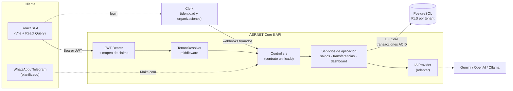

# Asistente Financiero

> Plataforma multi-empresa para registrar y entender las finanzas de un negocio: cuentas, categorías,
> transacciones y transferencias en ARS y USD, con saldos siempre consistentes y un dashboard en tiempo real.
> Diseñada para recibir movimientos por WhatsApp/Telegram y categorizarlos con IA.

Proyecto desarrollado por **Felipe Valenzuela** y **Diego Scopetta**. Este repositorio es una **vitrina**:
documenta el producto, la arquitectura y las decisiones técnicas. El código fuente vive en repositorios privados.

> 🎬 **Video demo, GIF y capturas: próximamente.** El material multimedia se va a ir sumando a medida que se
> completen las fases de desarrollo en curso.

[Arquitectura](docs/arquitectura.md)  ·  [Decisiones técnicas](docs/decisiones/)  ·  [Calidad y testing](docs/calidad.md)

---

## El problema

Las pymes y los profesionales independientes en Argentina suelen llevar sus finanzas en planillas sueltas:
varias cuentas (efectivo, bancos, billeteras virtuales, tarjetas), dos monedas con una cotización que cambia todos
los días y movimientos que llegan por WhatsApp o en un papel. El resultado son saldos que no cierran, gastos sin
categorizar y ninguna visión consolidada del negocio.

## La solución

Una aplicación web multi-empresa (multi-tenant) donde cada organización:

- **Registra sus cuentas** (efectivo, banco, tarjeta de crédito, billetera digital) en ARS o USD.
- **Carga ingresos, gastos y transferencias** entre cuentas, incluso entre monedas distintas: el monto acreditado se
  calcula con la cotización USD/ARS del día o se carga a mano.
- **Ve saldos siempre consistentes**: cada movimiento actualiza el saldo de forma atómica; solo las tarjetas de
  crédito pueden quedar en negativo y, si una operación dejaría otra cuenta en rojo, el sistema la rechaza con un
  mensaje que explica qué pasó y qué hacer.
- **Organiza** con categorías jerárquicas, archivado y borrado lógico (nada se pierde).
- **Entiende su situación** en un dashboard con ingresos, gastos, flujo neto, balance por cuenta, tendencia mensual
  y transacciones recientes editables.

Visión del producto (en desarrollo): los movimientos llegan por **WhatsApp/Telegram**, una **IA los interpreta y
categoriza**, quedan en una bandeja de **cuarentena** para revisión y, al aprobarlos, se convierten en transacciones.

## Capturas

> 🚧 **En preparación.** Las capturas del dashboard, de una transferencia entre monedas y del mensaje de saldo
> insuficiente se agregan al cerrar las fases de desarrollo en curso (ver [docs/img](docs/img/README.md)).

---

## Estado del proyecto

| Área | Estado |
|---|---|
| Autenticación y organizaciones (Clerk, JWT, alta automática de empresa y usuario) | ✅ Funcionando |
| Cuentas multi-moneda (ARS/USD), cambio de moneda con conversión | ✅ Funcionando |
| Categorías jerárquicas con archivado en cascada y borrado lógico | ✅ Funcionando |
| Transacciones con cálculo de monto en moneda base (ARS) por cotización | ✅ Funcionando |
| Saldos transaccionales, ajustes manuales auditables y transferencias atómicas | ✅ Funcionando |
| Dashboard con filtros y transacciones recientes editables | ✅ Funcionando |
| Contrato HTTP unificado + tests de contrato | ✅ Funcionando |
| Aislamiento multi-tenant | ✅ Por servicio · 🚧 Enforcement de RLS en PostgreSQL |
| Roles (Owner/Admin/Member/Viewer) | 🚧 En progreso |
| Bandeja de cuarentena + categorización con IA (adapter provider-agnostic) | 🚧 Interfaz y proveedor mock; Gemini pendiente |
| Entrada por WhatsApp/Telegram (Make.com) | 🗺 Planificado |
| Cotización diaria automática desde el BCRA (worker) | 🗺 Planificado (hoy: cotización cargada en base) |
| Exportación a Excel / Google Sheets con insights de IA | 🗺 Planificado |

---

## Stack

| Capa | Tecnologías |
|---|---|
| **Backend** | ASP.NET Core 8 (Web API), Clean Architecture + DDD ligero, EF Core 8 + Npgsql, FluentValidation |
| **Base de datos** | PostgreSQL 16, Row-Level Security para multi-tenancy, `decimal(18,2)` para montos, UUIDs |
| **Frontend** | React 18, TypeScript, Vite, TanStack React Query, Tailwind CSS, arquitectura por componentes |
| **Autenticación** | Clerk (organizaciones = tenants), validación JWT con `AddJwtBearer` + JWKS, webhooks firmados (Svix) |
| **IA** | Patrón Adapter/Strategy (`IAiProvider`), Google Gemini como proveedor por defecto |
| **Testing** | xUnit + Testcontainers (PostgreSQL real), tests de contrato HTTP, Vitest + Testing Library |
| **DevOps** | Docker / Docker Compose, GitHub Actions (CI con migraciones y analizadores, CD a GHCR), guardas de ramas |

## Arquitectura en una imagen

Más detalle (capas, flujo de una transacción, consistencia de saldos, multi-tenancy y adapter de IA) en
**[docs/arquitectura.md](docs/arquitectura.md)**.

## Decisiones técnicas destacadas

| # | Decisión | Por qué |
|---|---|---|
| [0001](docs/decisiones/0001-multi-tenancy-con-rls.md) | Multi-tenancy en una sola base con Row-Level Security | Aislamiento a nivel de base de datos sin el costo operativo de una base por cliente |
| [0002](docs/decisiones/0002-adapter-ia-provider-agnostic.md) | Adapter de IA provider-agnostic | Cambiar de proveedor (Gemini, OpenAI, Anthropic, Ollama) sin tocar la lógica de negocio |
| [0003](docs/decisiones/0003-auth-gestionada-con-clerk.md) | Auth gestionada (Clerk) + validación JWT estándar | Organizaciones, MFA y gestión de sesiones resueltas; el backend solo valida tokens |
| [0004](docs/decisiones/0004-precision-financiera-y-multimoneda.md) | `decimal`, moneda base ARS y cotización guardada por transacción | Precisión exacta y reportes históricos que no cambian cuando cambia el dólar |
| [0005](docs/decisiones/0005-saldos-consistentes.md) | Saldos incrementales con bloqueo de filas | Saldos correctos bajo concurrencia, verificados con un invariante |
| [0006](docs/decisiones/0006-contrato-http-unificado.md) | Contrato HTTP unificado | Un solo formato de respuesta y error para todo el frontend |

## Calidad

- **~840 tests automatizados**: 162 unitarios + 324 de integración en el backend (PostgreSQL real con
  Testcontainers) y 354 en el frontend.
- Casos derivados de un **plan de pruebas con reglas de negocio numeradas** (D1–D24) y trazabilidad caso → regla.
- Tests de **concurrencia** (20 gastos en paralelo sobre la misma cuenta) y de **invariante** (50 operaciones
  aleatorias con semilla fija, el saldo siempre cuadra).
- CI con `dotnet format`, analizadores con *warnings as errors*, migraciones contra PostgreSQL y lint/typecheck en
  el frontend.

Ver **[docs/calidad.md](docs/calidad.md)**.

## Mi rol

Somos dos desarrolladores. La forma de repartirnos el trabajo evolucionó con el proyecto:

1. **Primera etapa — por capas.** Yo tomé el **backend** (API en .NET, modelo de datos, multi-tenancy,
   autenticación con Clerk, CI/CD) y Diego el **frontend** (React).
2. **Etapa actual — por features de punta a punta.** Cada uno es dueño de una funcionalidad completa, desde la base
   de datos hasta la interfaz, incluidos sus tests y su documentación.

| | Felipe Valenzuela | Diego Scopetta |
|---|---|---|
| **Etapa por capas** | Backend: arquitectura Clean Architecture, API, modelo de datos, multi-tenancy, auth, CI/CD | Frontend: SPA en React, integración con Clerk, UI |
| **Etapa por features** | **Saldos y transferencias**: saldos consistentes con bloqueo de filas, transferencias atómicas entre monedas, ajustes auditables, filtros del dashboard | **Cuarentena**: bandeja de entrada de movimientos y su revisión y aprobación |

Pasar de capas a features nos dio menos dependencias entre los dos (cada feature se diseña, implementa y prueba
completa) y nos obligó a acordar antes el contrato de la API, que hoy es la referencia común de ambos lados.

## Contacto

> Datos de contacto: próximamente.
