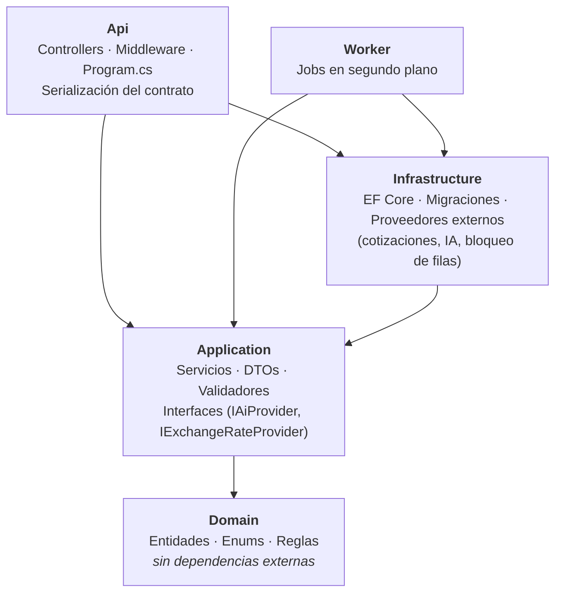
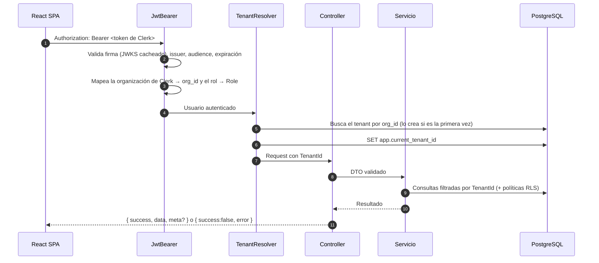
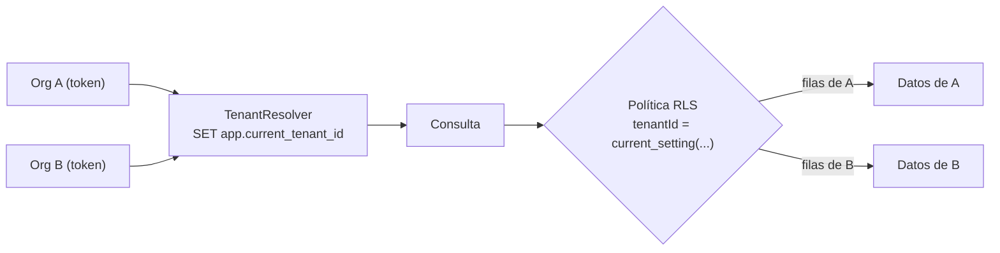
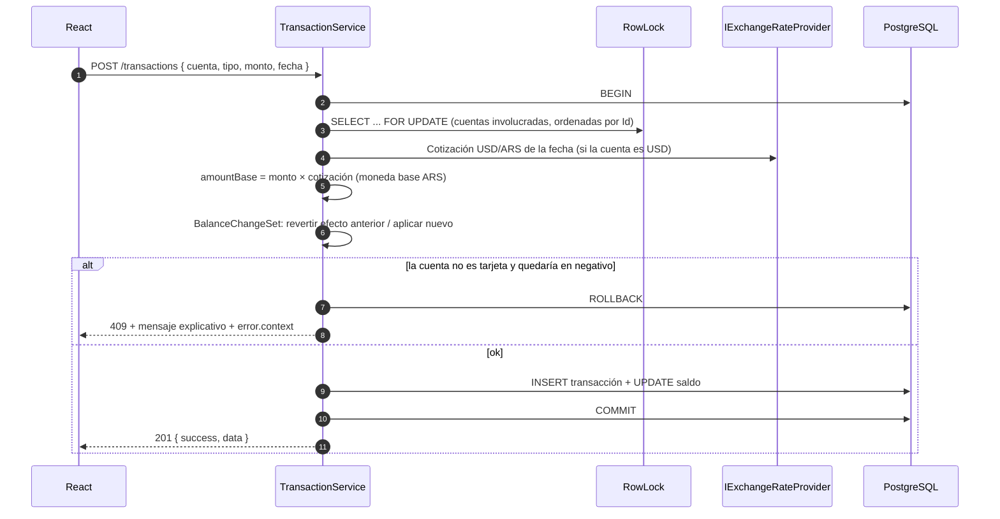
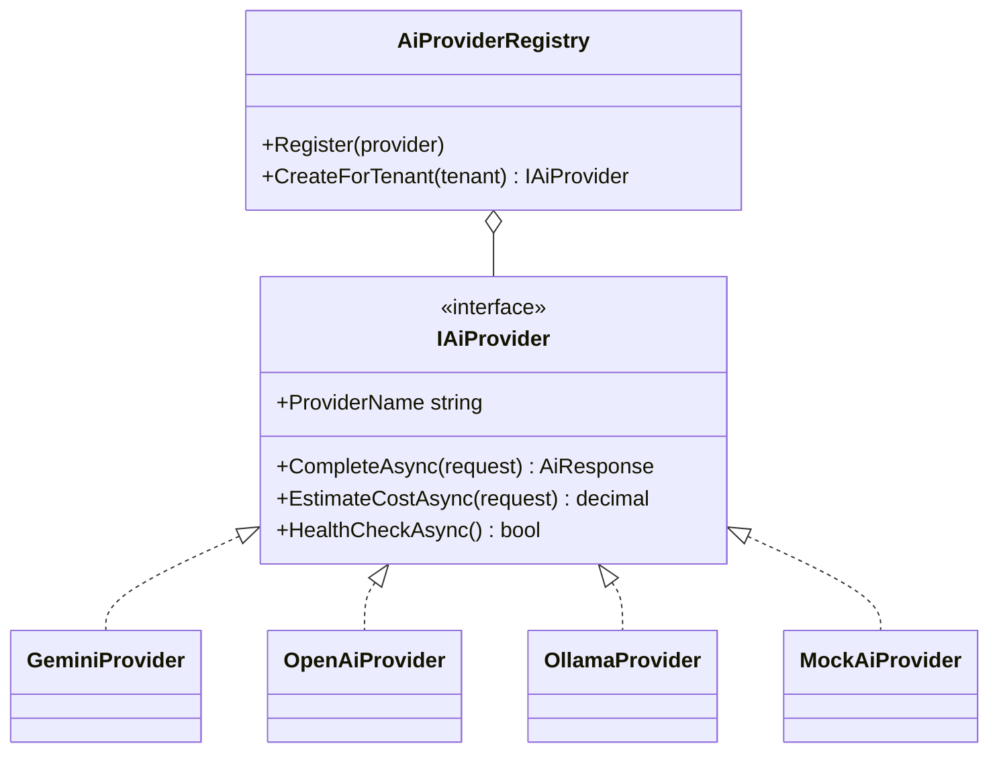
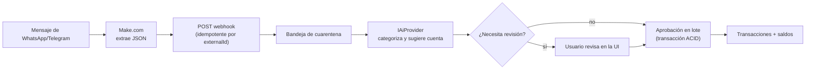
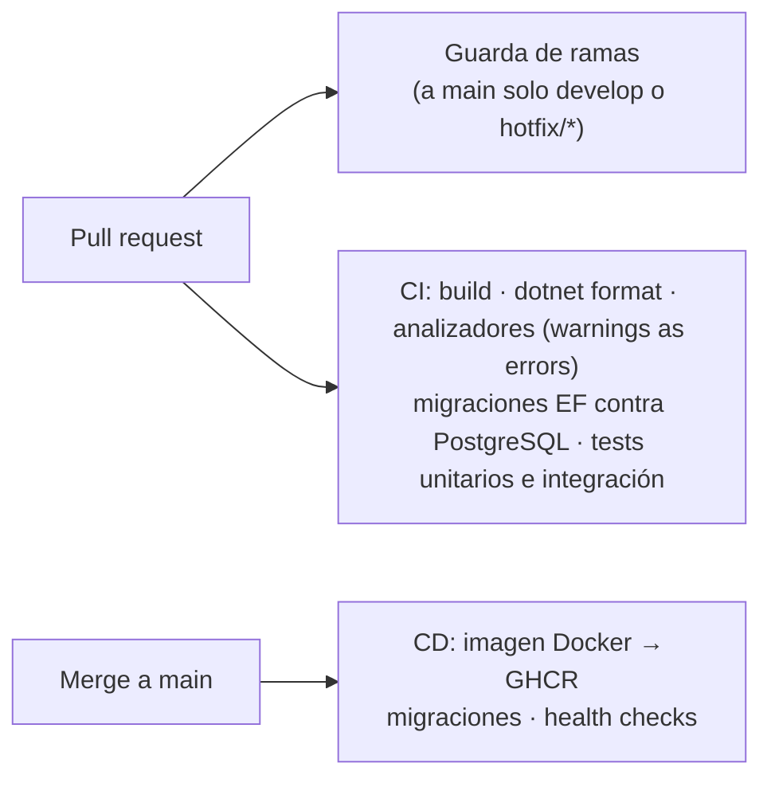

# Arquitectura

[← Volver al README](../README.md)

## 1. Vista general

Dos aplicaciones desplegables y servicios externos gestionados:

| Pieza | Responsabilidad |
|---|---|
| **SPA React** | UI por componentes reutilizables (formularios, tablas, acciones y diálogos compartidos entre secciones), estado de servidor con React Query |
| **API ASP.NET Core 8** | Reglas de negocio, consistencia de saldos, contrato HTTP, multi-tenancy |
| **Worker** (planificado) | Cotización diaria del BCRA, exportaciones, enriquecimiento con IA |
| **PostgreSQL 16** | Única fuente de verdad, aislamiento por tenant con Row-Level Security |
| **Clerk** | Identidad, organizaciones (cada organización es un tenant), webhooks de sincronización |
| **Proveedor de IA** | Interpretación y categorización de movimientos, detrás de un adapter |

## 2. Capas del backend (Clean Architecture)

La regla de dependencias apunta siempre hacia el dominio. Las entidades protegen sus invariantes (por ejemplo,
`Account` decide si una cuenta puede quedar en negativo y `Transaction` valida montos y fechas), los servicios de
aplicación orquestan y la infraestructura implementa las interfaces.

## 3. Pipeline de una request

- **Errores 401/403** se escriben desde los eventos del autenticador con el mismo formato de error que el resto de
  la API.
- **El tenant y el creador salen siempre del token**: el cliente nunca puede mandar `tenantId` ni `createdById`.

## 4. Multi-tenancy

Defensa en profundidad con dos capas:

1. **Aplicación**: cada servicio filtra por `TenantId`; un recurso de otra organización responde 404 (no 403, para
   no revelar que existe).
2. **Base de datos**: todas las tablas con datos de clientes tienen políticas RLS por `tenantId`.
   _Estado: las políticas están definidas; activar su enforcement (rol de base sin privilegios de dueño,
   `FORCE ROW LEVEL SECURITY` y `SET LOCAL` por transacción) es parte de la fase de seguridad en curso._

Ver la decisión [0001](decisiones/0001-multi-tenancy-con-rls.md).

## 5. Flujo de una transacción y consistencia de saldos

Reglas clave:

- `Saldo = Saldo inicial + Σ movimientos que afectan el saldo y no están eliminados`. Un test verifica este
  invariante tras 50 operaciones aleatorias.
- **Transferencias**: dos movimientos (`TRANSFER_OUT` + `TRANSFER_IN`) enlazados por `TransferId`, creados,
  editados y eliminados siempre juntos en una sola transacción de base. Entre monedas, el monto acreditado sale de
  la cotización o lo carga el usuario.
- **Ajustes manuales** de saldo quedan registrados como movimientos (`ADJUSTMENT_IN/OUT`): ningún cambio de saldo
  es invisible.
- **Archivar** solo ordena la vista; **eliminar** revierte el saldo. Cada movimiento tiene un checkbox «Afecta el
  saldo».
- **Concurrencia**: bloqueo pesimista de filas en orden determinístico (evita *lost updates* y deadlocks),
  verificado con 20 operaciones en paralelo.

Ver la decisión [0005](decisiones/0005-saldos-consistentes.md).

## 6. IA: adapter provider-agnostic y cuarentena

_Estado: la interfaz `IAiProvider` y un proveedor mock determinístico (para tests) existen; el proveedor Gemini, el
registro por tenant y la entrada por Make.com están planificados._ Ver la decisión
[0002](decisiones/0002-adapter-ia-provider-agnostic.md).

## 7. Frontend

- **Arquitectura por componentes**: `TransactionFormModal`, `TransferModal`, `TransactionsTable`,
  `AffectsBalanceCheckbox` y el hook `useTransactionActions` se comparten entre la pantalla de Transacciones y el
  Dashboard, sin duplicar UI.
- **Estado de servidor** con React Query: query keys por tenant e invalidación centralizada (cualquier operación
  que mueva saldos refresca cuentas, transacciones y dashboard).
- **Cliente HTTP único** que valida el formato del contrato y transforma los errores en `ApiError` con detalles
  por campo y contexto estructurado.
- **Errores legibles**: los rechazos de negocio (por ejemplo, saldo insuficiente) se muestran completos dentro del
  formulario o en un diálogo, nunca en un toast que se corta.

## 8. CI/CD

